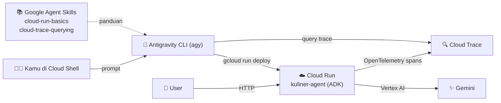

# Production-Grade AI Agents: Automated Cloud Run Deployment & End-to-End Tracing with Google Agent Skills

Workshop hands-on: membangun AI agent sederhana dengan **Google ADK**, men-deploy-nya ke
**Cloud Run** secara otomatis menggunakan **Antigravity CLI + [Google Agent Skills](https://github.com/google/skills)**,
lalu menelusuri setiap langkah agent (panggilan LLM, panggilan tool) lewat **Cloud Trace**.

Semua langkah dikerjakan di **Google Cloud Shell**, jadi setiap peserta punya lingkungan yang sama
dan tidak perlu menginstall apa pun di laptop.

⏱️ Durasi: ±90 menit  ·  🎯 Level: pemula–menengah  ·  💰 Biaya: sangat kecil (tertutup free trial, asal cleanup di akhir)

---

## Daftar Isi

1. [Gambaran Besar](#1-gambaran-besar)
2. [Persiapan Sebelum Workshop](#2-persiapan-sebelum-workshop)
3. [Struktur Project](#3-struktur-project)
4. [Langkah-langkah Workshop](#4-langkah-langkah-workshop)
5. [Troubleshooting](#5-troubleshooting)
6. [Apa yang Membuat Ini "Production-Grade"?](#6-apa-yang-membuat-ini-production-grade)

---

## 1. Gambaran Besar

Kita akan membuat **"Arek Kuliner"** 🍜, AI agent pemandu kuliner Surabaya dengan 3 tool:

| Tool | Fungsi | Catatan |
|---|---|---|
| `cari_kuliner(area)` | Rekomendasi tempat makan per area | data dummy |
| `cek_antrian(nama_tempat)` | Perkiraan lama antrian | **sengaja lambat 1–4 detik** 🐢 untuk latihan tracing |
| `hitung_budget(total_harga, jumlah_orang)` | Hitung patungan + pajak 10% | |



**Apa itu Agent Skills?** Skill adalah folder berisi `SKILL.md`, dokumen referensi, dan script yang mengajari
coding agent cara mengerjakan tugas tertentu sesuai best practice resmi Google. Kita tidak perlu
hafal semua flag `gcloud`; cukup minta ke Antigravity CLI, dan Antigravity CLI mengikuti panduan dari skill.

Skill yang dipakai:

| Skill | Dipakai untuk |
|---|---|
| [`cloud-run-basics`](https://github.com/google/skills/tree/main/skills/cloud/cloud-run-basics) | Deploy & konfigurasi Cloud Run |
| [`cloud-trace-querying`](https://github.com/google/skills/tree/main/skills/cloud/cloud-trace-querying) | Mencari & membedah trace, menemukan bottleneck latency |
| [`cloud-run-alert-configuration`](https://github.com/google/skills/tree/main/skills/cloud/cloud-run-alert-configuration) | *(bonus)* Alert latency & error |
| [`cloud-logging-query-generation`](https://github.com/google/skills/tree/main/skills/cloud/cloud-logging-query-generation) | *(bonus)* Query log |

---

## 2. Persiapan Sebelum Workshop

### Yang perlu disiapkan peserta (H-1, maksimal 10 menit)

| # | Kebutuhan | Keterangan |
|---|---|---|
| 1 | **Laptop + browser Chrome** | Tidak perlu install apa pun |
| 2 | **Akun Google pribadi (Gmail)** | Hindari akun kantor/kampus, karena sering dibatasi admin (Cloud Shell atau IAM bisa diblokir) |
| 3 | **Project Google Cloud dengan billing aktif** | Buat di [console.cloud.google.com/projectcreate](https://console.cloud.google.com/projectcreate), lalu hubungkan ke billing. Bisa pakai [free trial $300](https://cloud.google.com/free) atau kredit dari panitia |
| 4 | **Catat Project ID** | Contoh: `workshop-agent-12345`. Project ID **bukan** nama project |

> ⚠️ Billing yang belum aktif adalah penyebab error nomor 1 di workshop. Pastikan sudah aktif sebelum hari H.

### Yang sudah tersedia di Cloud Shell (tidak perlu diinstall)

| Tool | Dipakai untuk |
|---|---|
| `gcloud` (sudah login otomatis) | Deploy, IAM, API |
| Node.js + `npx` | Install Google Agent Skills |
| Python 3 + `venv` | Menjalankan agent di Cloud Shell & script skill trace |
| `git`, `curl` | Clone repo, test API |

### Yang akan diinstall selama workshop

| Apa | Perintah | Di langkah |
|---|---|---|
| Google ADK (`google-adk[gcp]`) | `pip install -r requirements.txt` | Langkah 4 (opsional, untuk uji coba di Cloud Shell) |
| Google Agent Skills | `npx skills add google/skills ...` | Langkah 5 |
| Antigravity CLI (`agy`), coding agent | `curl -fsSL https://antigravity.google/cli/install.sh \| bash` | Langkah 5 |

---

## 3. Struktur Project

```
.
├── kuliner_agent/
│   ├── __init__.py
│   └── agent.py               # ⭐ Definisi agent + 3 tool (ADK)
├── main.py                    # Server FastAPI + export trace ke Cloud Trace
├── Dockerfile                 # Container untuk Cloud Run
├── requirements.txt           # google-adk[gcp] (versi dikunci)
├── .env.example               # Template konfigurasi
├── .gcloudignore              # File yang tidak ikut di-upload saat deploy
├── scripts/
│   ├── 00_init.sh             # Cek project & billing, buat .env
│   ├── 01_setup_gcp.sh        # Enable API + service account + IAM
│   ├── 02_deploy.sh           # Deploy manual (cadangan kalau Antigravity CLI bermasalah)
│   ├── 03_generate_traffic.sh # Kirim pertanyaan ke agent -> menghasilkan trace
│   └── 99_cleanup.sh          # Hapus semua resource
└── prompts/
    ├── 01_deploy.md           # Prompt deploy otomatis (skill cloud-run-basics)
    ├── 02_trace.md            # Prompt analisis trace (skill cloud-trace-querying)
    └── 03_bonus.md            # Alert, logging, perbaikan latency
```

Inti tracing hanya **satu argumen** di `main.py`:

```python
app = get_fast_api_app(agents_dir=AGENT_DIR, web=True, trace_to_cloud=True, ...)
```

ADK otomatis membuat span untuk setiap langkah agent:

```
invoke_workflow kuliner_agent
└── invoke_agent kuliner_agent
    ├── generate_content gemini-3.5-flash   ← Gemini memutuskan memanggil tool
    ├── execute_tool cek_antrian            ← 🐢 si lambat (1–4 detik)
    └── generate_content gemini-3.5-flash   ← Gemini menyusun jawaban
```

---

## 4. Langkah-langkah Workshop

> 💡 **Konvensi:** blok kode yang diawali `$` dijalankan di **terminal Cloud Shell**.
> Blok yang diketik di dalam Antigravity CLI ditandai **"di Antigravity CLI"**.

### Langkah 1 — Buka Cloud Shell & ambil kode (5 menit)

1. Buka **https://shell.cloud.google.com** dan login dengan akun Google kamu.
   Kalau muncul dialog **Authorize Cloud Shell**, klik **Authorize**.
2. Set project. Ganti `PROJECT_ID_KAMU` dengan Project ID kamu:

   ```bash
   export GOOGLE_CLOUD_PROJECT=PROJECT_ID_KAMU
   gcloud config set project $GOOGLE_CLOUD_PROJECT
   ```

   Prompt terminal akan berubah menampilkan project ID berwarna kuning.

3. Clone repo workshop dan masuk ke foldernya:

   ```bash
   cd ~
   git clone https://github.com/suhriar/devfest-prod-agents-workshop.git
   cd ~/devfest-prod-agents-workshop
   ```

> 🔁 **Kalau Cloud Shell terputus** (idle terlalu lama, atau tab ditutup), file kamu tetap aman. Setelah reconnect,
> jalankan lagi perintah berikut:
> ```bash
> export GOOGLE_CLOUD_PROJECT=PROJECT_ID_KAMU
> gcloud config set project $GOOGLE_CLOUD_PROJECT
> export PATH="$HOME/.local/bin:$PATH"
> cd ~/devfest-prod-agents-workshop
> ```

### Langkah 2 — Inisialisasi (1 menit)

```bash
./scripts/00_init.sh
```

Script ini mengecek project & billing, lalu membuat file `.env`. Output yang diharapkan:

```
✅ Project aktif : workshop-agent-12345
✅ Akun          : kamu@gmail.com
✅ Billing aktif
✅ File .env dibuat:
   GOOGLE_CLOUD_PROJECT=workshop-agent-12345
   ...
```

### Langkah 3 — Siapkan Google Cloud (3–5 menit, cukup sekali)

```bash
./scripts/01_setup_gcp.sh
```

Yang dilakukan script:
1. Mengaktifkan API: Compute, Cloud Run, Cloud Build, Artifact Registry, Vertex AI, Cloud Trace, Logging, dan Monitoring.
2. Membuat service account `kuliner-agent-sa` dengan **hak akses minimum**: memanggil Gemini, mengirim trace, menulis log.
3. Memberi Cloud Build role `roles/run.builder`, sesuai panduan skill `cloud-run-basics`.

Tunggu sampai muncul `✅ Setup GCP selesai`, lalu **tunggu ±1 menit** agar izin IAM aktif.

### Langkah 4 — (Opsional) Coba agent langsung di Cloud Shell (10 menit)

```bash
python3 -m venv .venv
source .venv/bin/activate
pip install -q -r requirements.txt
adk telemetry disable
echo "Alamat Web Preview: https://8080-$WEB_HOST"
adk web --host 0.0.0.0 --port 8080 --allow_origins "https://8080-$WEB_HOST"
```

> - `adk telemetry disable` mencegah munculnya pertanyaan *"Enable telemetry? [Y/n]"*.
>   Kalau pertanyaan itu tetap muncul, ketik `n` lalu Enter. Hati-hati: Enter tanpa mengetik apa pun dianggap **Yes**.
> - `--allow_origins` **wajib** di Cloud Shell. Tanpa flag ini, ADK menolak file JavaScript Dev UI
>   dari alamat Web Preview (log menampilkan `403 Forbidden`, halaman kosong).
>   `$WEB_HOST` sudah disediakan otomatis oleh Cloud Shell.

1. Klik tombol **Web Preview** (ikon 👁️ / `<>` di toolbar Cloud Shell) → **Preview on port 8080**.
2. Pilih `kuliner_agent` di kiri atas, lalu tanya: *"Rekomendasi kuliner di Surabaya timur dan cek antriannya"*.
3. Klik tab **Trace** di Dev UI untuk melihat langkah-langkah agent. Ini versi lokal dari apa yang nanti kita lihat di Cloud Trace.
4. Selesai? Tekan `Ctrl+C` lalu jalankan `deactivate`.

### Langkah 5 — Install Google Agent Skills & Antigravity CLI (5 menit)

**5a. Install skill** dari folder `~/devfest-prod-agents-workshop`:

```bash
cd ~/devfest-prod-agents-workshop
npx -y skills add google/skills \
  -s cloud-run-basics \
  -s cloud-trace-querying \
  -s cloud-run-alert-configuration \
  -s cloud-logging-query-generation \
  -a antigravity-cli -y
```

Output yang diharapkan: 4 baris `✓ <nama-skill> (copied) → ./.agents/skills/<nama-skill>` diakhiri `Done!`.

**5b. Install Antigravity CLI (`agy`)**, coding agent dari Google:

```bash
curl -fsSL https://antigravity.google/cli/install.sh | bash
export PATH="$HOME/.local/bin:$PATH"
```

> ⚠️ Jangan install lewat `apt`. Paket `antigravity` di `apt` adalah aplikasi desktop, bukan CLI.

**5c. Buka Antigravity CLI dari folder project & login:**

```bash
cd ~/devfest-prod-agents-workshop
agy
```

1. Saat muncul *Select login method*, pilih **1. Google OAuth**.
2. `agy` menampilkan sebuah URL. Buka URL itu di tab browser baru, login dengan **akun Google yang sama** dengan Cloud Shell, lalu klik *Allow*.
3. Kalau browser menampilkan kode, salin dan tempel ke terminal, lalu Enter. Lakukan dengan cepat, karena prompt bisa kedaluwarsa. Kalau kedaluwarsa, jalankan `agy` lagi.

**5d. Verifikasi skill terbaca.** Ketik **di Antigravity CLI**:

```
/skills
```

Di bagian **Workspace skills** harus muncul empat skill: `cloud-logging-query-generation`, `cloud-run-alert-configuration`,
`cloud-run-basics`, dan `cloud-trace-querying`. Skill lain di bagian *Shared skills* adalah bawaan Cloud Shell. Biarkan saja.

### Langkah 6 — 🚀 Deploy otomatis ke Cloud Run dengan skill (10–15 menit)

Buka [`prompts/01_deploy.md`](prompts/01_deploy.md) (bisa lewat **Open Editor** di Cloud Shell), salin prompt-nya,
lalu tempel **di Antigravity CLI**.

Yang akan terjadi:
1. Antigravity CLI memuat skill `cloud-run-basics` dan menyusun rencana deploy.
2. Sebelum menjalankan perintah, Antigravity CLI akan **meminta persetujuanmu**. Baca dulu perintahnya, baru setujui.
3. Cloud Build membangun image dari `Dockerfile`, kemudian Cloud Run menjalankannya (±3–5 menit).
4. Antigravity CLI menampilkan URL service dan mengetes `/healthz`.

✅ **Berhasil jika** muncul URL seperti `https://kuliner-agent-xxxxxxxx.us-central1.run.app` dan `/healthz` membalas `{"status":"ok"}`.

<details>
<summary>🛟 <b>Cara cadangan</b>: deploy tanpa Antigravity CLI</summary>

Buka tab terminal baru di Cloud Shell (ikon **+**), lalu jalankan:

```bash
cd ~/devfest-prod-agents-workshop
./scripts/02_deploy.sh
```

Script ini menjalankan perintah `gcloud run deploy` yang sama persis dengan konfigurasi production di prompt.
</details>

### Langkah 7 — Coba agent & hasilkan traffic (5 menit)

1. Buka `https://<URL-SERVICE>/dev-ui/` di tab browser baru, lalu chat dengan agent.
2. Di terminal Cloud Shell, buka tab baru (ikon **+**) dan kirim 5 pertanyaan otomatis:

   ```bash
   cd ~/devfest-prod-agents-workshop
   ./scripts/03_generate_traffic.sh
   ```

   Setiap pertanyaan menghasilkan 1 trace. Tunggu **±1 menit** sampai trace masuk ke Cloud Trace.

### Langkah 8 — 🔍 End-to-end tracing (20 menit)

**8a. Lihat lewat Console**, supaya paham tampilannya:

1. Buka [Trace Explorer](https://console.cloud.google.com/traces/explorer).
2. Klik salah satu trace untuk melihat *waterfall* span: `invoke_workflow` → `invoke_agent` → `generate_content` / `execute_tool`.
3. Klik span `generate_content ...` dan lihat atribut `gen_ai.*`: model dan jumlah token input/output.
4. Klik span `execute_tool cek_antrian` dan perhatikan durasinya 🐢.

**8b. Lewat Antigravity CLI + skill `cloud-trace-querying`:**

Buka [`prompts/02_trace.md`](prompts/02_trace.md) dan jalankan prompt 2a → 2d secara berurutan **di Antigravity CLI**.
Antigravity CLI akan menjalankan script dari skill (`search_traces`, `fetch_entire_trace`, `fetch_related_logs`,
`generate_links`) dan menyimpulkan bahwa **`cek_antrian` adalah bottleneck**.

> 💡 Inti workshop: coding agent tidak hanya bisa men-deploy, tapi juga **mengobservasi** dan
> **mendiagnosis** sistem production dengan data nyata.

### Langkah 9 — Bonus: lebih production-ready (opsional)

Lihat [`prompts/03_bonus.md`](prompts/03_bonus.md):
- Perbaiki bottleneck, redeploy, lalu bandingkan latency sebelum & sesudah.
- Pasang **alert** latency & error rate (`cloud-run-alert-configuration`).
- Query **log** error (`cloud-logging-query-generation`).

### Langkah 10 — 🧹 Cleanup (WAJIB, 2 menit)

```bash
cd ~/devfest-prod-agents-workshop
./scripts/99_cleanup.sh
```

Ketik `y` untuk konfirmasi. Script menghapus Cloud Run service, service account, dan image di Artifact Registry.
Mau benar-benar bersih? Hapus seluruh project di
[Manage resources](https://console.cloud.google.com/cloud-resource-manager).

---

## 5. Troubleshooting

| Masalah | Solusi |
|---|---|
| `00_init.sh`: *Project belum dipilih* | Jalankan `gcloud config set project PROJECT_ID_KAMU`. |
| `00_init.sh`: *Billing BELUM aktif* | Buka link yang ditampilkan script, hubungkan ke billing account, lalu ulangi. |
| `01_setup_gcp.sh`: `Billing account ... is not found` | Sama seperti di atas. Billing wajib untuk enable API. |
| `PERMISSION_DENIED` saat setup/deploy | Pastikan akunmu **Owner** di project (otomatis kalau kamu yang membuat project). Tunggu 1–2 menit setelah setup, lalu ulangi. |
| Deploy gagal di tahap build (`Build failed`) | Biasanya karena izin IAM belum aktif. Tunggu 1 menit, lalu jalankan ulang `./scripts/01_setup_gcp.sh` dan deploy lagi. |
| Deploy gagal: `allow-unauthenticated ... organization policy` | Akunmu dibatasi kebijakan organisasi. Pakai Gmail pribadi dengan project baru. |
| `agy: command not found` | Jalankan `export PATH="$HOME/.local/bin:$PATH"`. Tab terminal baru biasanya sudah otomatis. |
| Login `agy` gagal / kode kedaluwarsa | Jalankan `agy` lagi dan ulangi login dengan cepat. Kalau Google OAuth tetap ditolak, pilih **2. Use a Google Cloud project** dan masukkan Project ID kamu. |
| Antigravity CLI tidak menemukan skill workshop | Keluar, pastikan berada di `~/devfest-prod-agents-workshop` (ada folder `.agents/skills`), lalu jalankan `agy` lagi. |
| Agent membalas error `404 ... model not found` | Ubah `MODEL` di `.env` (misal `gemini-2.5-flash`), lalu deploy ulang. |
| Trace tidak muncul | Tunggu 1–2 menit dan refresh. Pastikan deploy memakai flag `--no-cpu-throttling` dan env `TRACE_TO_CLOUD=true`. |
| Script skill trace: `Could not automatically determine credentials` | Jalankan `gcloud auth application-default login` di terminal Cloud Shell. |
| Cloud Shell terputus / file seperti hilang | Reconnect, lalu `cd ~/devfest-prod-agents-workshop`. Folder home tetap tersimpan. |
| Langkah 4: Dev UI kosong, log `GET /dev-ui/*.js 403 Forbidden` | `adk web` dijalankan tanpa `--allow_origins`. Tekan `Ctrl+C`, lalu jalankan perintah `adk web ... --allow_origins "https://8080-$WEB_HOST"` dari Langkah 4. |
| Langkah 4: `$WEB_HOST` kosong | Salin alamat dari address bar tab Web Preview, cukup bagian `https://8080-....cloudshell.dev` tanpa path, lalu pakai sebagai nilai `--allow_origins`. |
| Lihat log error service | `gcloud run services logs read kuliner-agent --region us-central1 --limit 50` |

---

## 6. Apa yang Membuat Ini "Production-Grade"?

**Sudah diterapkan di workshop ini:**

- ✅ **Service account khusus** dengan prinsip *least privilege*, bukan default compute SA.
- ✅ **Container non-root** yang listen di `0.0.0.0:$PORT`, plus endpoint `/healthz`.
- ✅ **Autoscaling terkontrol**: `min-instances 0` (hemat), `max-instances 3` (batas biaya), `concurrency`, `timeout`, startup CPU boost.
- ✅ **Telemetry yang andal**: `--no-cpu-throttling` agar trace yang dikirim di background tidak hilang.
- ✅ **Session affinity** agar percakapan dari user yang sama diarahkan ke instance yang sama.
- ✅ **Konfigurasi lewat env var**, bukan hard-code (model, project, toggle tracing).
- ✅ **Versi dependency dikunci** (`google-adk[gcp]==2.14.1`) agar build bisa diulang dengan hasil sama.
- ✅ **Observability end-to-end**: setiap panggilan LLM & tool tercatat di Cloud Trace (OpenTelemetry, konvensi `gen_ai.*`).
- ✅ **Label resource** untuk tracking biaya.

**Langkah berikutnya untuk production sungguhan:**

- 🔒 Matikan `--allow-unauthenticated`; pakai IAM / IAP / API Gateway.
- 💾 Simpan session di database (Cloud SQL / Firestore / Agent Platform Sessions), bukan di disk instance.
- 🔁 CI/CD otomatis dengan Cloud Build trigger atau GitHub Actions (skill `cloud-build-basics`).
- 📊 Alert & SLO (skill `cloud-run-alert-configuration`, `google-cloud-slo-alert-configuration`).
- 🧪 Evaluasi kualitas agent sebelum rilis (lihat [agents-cli](https://github.com/google/agents-cli)).
- 🙈 Hati-hati merekam isi prompt/response di trace jika berisi data pribadi.

---

## Referensi

- Google Agent Skills: https://github.com/google/skills
- Agent Development Kit (ADK): https://google.github.io/adk-docs/
- Cloud Shell: https://cloud.google.com/shell/docs
- Antigravity CLI: https://antigravity.google/docs/cli-overview
- Cloud Run: https://cloud.google.com/run/docs
- Cloud Trace: https://cloud.google.com/trace/docs
